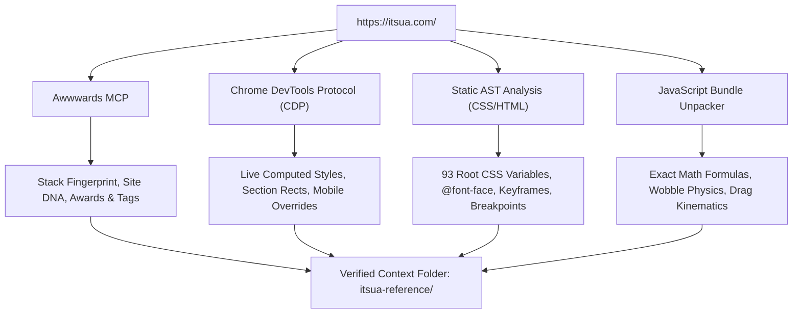

# Extraction Methodology & Confidence Assessment

**Target:** `https://itsua.com/`  
**Execution Context:** Awwwards MCP + Headless Chrome CDP  

---

## 1. Multi-Vector Extraction Strategy

To achieve absolute technical accuracy without fabrication, four distinct inspection mechanisms were executed:

---

## 2. Tools & Protocols Executed

### A. Awwwards MCP Tools
1. `search_sites`: Verified site listing, canonical slug (`itsua`), jury tags, and award category classification.
2. `analyze_stack`: Extracted core framework markers (`Astro`, `Tailwind`, custom color and grid classes).
3. `analyze_bundle`: Discovered and unpacked 14 internal script chunks directly into temporary analysis stores, identifying ES modules (`FeaturedDeck`, `ReviewCard`, `Base`, `Popups`, `deck.js`).
4. `audit_url`: Conducted live Chrome CDP runtime frame audit, discovering passive scroll listener bindings, layout thrash hot spots, and animated CSS property classes.
5. `build_motion_manifest` & `build_gsap_stub`: Generated scaffolded motion manifests and timeline stub configurations from extracted section bands.

### B. Chrome DevTools Protocol (CDP) Instrumentation
Using native Node.js (v22) and headless Google Chrome (`chrome.exe` on Windows):
1. **Target Attachment:** Connected via WebSocket to `http://127.0.0.1:9222/devtools/browser/`.
2. **Desktop Viewport Evaluation:** Initialized at `1440 x 900` pixels. Executed runtime queries extracting:
   - `getBoundingClientRect()` for all 10 page sections and key components.
   - `window.getComputedStyle()` for colors, padding, margins, borders, typography, display, and transforms.
3. **Mobile Viewport Emulation:** Overrode device metrics to `390 x 844` pixels (deviceScaleFactor: 3, mobile: true, touchEmulationEnabled: true). Re-evaluated section bounding rects, display changes, and font-size scales.
4. **Visual Evidence:** Captured full-fidelity desktop (`itsua-desktop.png`) and mobile (`itsua-mobile.png`) reference screenshots.

### C. Static AST & Stylesheet Extraction
1. Downloaded and parsed production stylesheets:
   - `Base.CGMHpWBi.css` (63,573 characters)
   - `ReviewCard.DZefoKtB.css` (5,482 characters)
2. Extracted 93 CSS root variables, 9 `@font-face` blocks, 14 media query breakpoints, and keyframe animations.
3. Localized binary `.woff2` font files for Space Grotesk and JetBrains Mono.

### D. Reverse Engineering of Minified Scripts
By tracing extracted JavaScript modules (`0-inline.js` to `12-deck.js`), exact runtime formulas were isolated:
- Card wobble oscillation: `15 * Math.sin(Math.PI * t) * Math.sin(2 * Math.PI * t)`
- Smooth exponential lerp filter: `l = l + t * 0.16`
- Scroll exit offset: `m = -Math.max(0, Math.min(1, (h - (r - 1 - E) * 14) / 150)) * 1200`
- Door table bounding-box projection: `--cx`, `--cy`, `--rw`, `--rh` with 110ms stagger.

---

## 3. Evidence Classification Standard

Every data point in this reference package is tagged according to the following strict criteria:

| Tag | Definition | Example in this Extraction |
|---|---|---|
| **[VERIFIED]** | Directly measured or extracted via CDP, stylesheet AST, or bundle decompilation. Absolute fidelity. | CSS variables (`--color-paper: #f5f5f3`), card dimensions (`395.2px x 224px`), font sizes (`12px`, `16px`). |
| **[OBSERVED]** | Directly witnessed during interactive execution and screen captures. | Hovering over card initiates spring wobble; clicking card triggers 180° flip. |
| **[ESTIMATED]** | Approximated mathematically when runtime values vary continuously. | Touch velocity decay duration (estimated 300–450ms). |
| **[UNVERIFIED]** | Stated by external third-party or convention but not directly verified in code. | Backend CMS sync mechanism behind the static build. |
| **[UNAVAILABLE]** | Not exposed to public client-side runtime. | Production database schema, private build pipeline scripts. |

